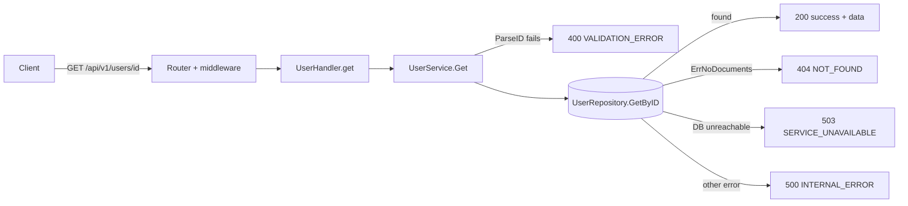

# Approved plan (version 2)

- Repository: `HeroicHorizon/DEMOAI`, base branch `main` at `e1d84b7508b67d4228c1c9222a54e9eb921732a3`
- Plan SHA-256: `6ff3a7fb53548c6df442ae69f72b4a468413229ccda68217003c600c73680b0e` (of the plan as approved; @​-mentions below are neutralised)
- Approval record: https://github.com/HeroicHorizon/DEMOAI/issues/3#issuecomment-6585217625

---

## Summary
The ForgeFlow backend already serves `GET /api/v1/users/{id}`. It is registered at `backend/internal/handler/user_handler.go:25` and handled by `get` and `UserService.Get`. It already returns 200, 400 for a malformed id, and 404 for a missing user. The 500 path comes from `apperror.As` and `FromMongo`. So this change adds no new route. It checks the existing endpoint against each acceptance criterion and fills the test gaps. Production code changes only if a new test shows a criterion is not met.

## Acceptance criteria
Copied from the request:
1. A valid user ID returns that user's details.
2. A found user returns 200 OK with the user's details in the response body.
3. A user that does not exist returns 404 Not Found.
4. An invalid or missing user ID returns 400 Bad Request.
5. An unexpected server-side failure returns 500 Internal Server Error.
6. The response follows the existing API response structure.
7. Unit tests cover successful retrieval, user not found, invalid input, and unexpected errors.
8. The endpoint is verified through API-level or integration tests.

## Facts and assumptions
- [fact] `GET /api/v1/users/{id}` is registered in `backend/internal/handler/user_handler.go:25`, and `get` returns `writeOK(w, 200, u, nil)` (`user_handler.go:81-88`).
- [fact] `UserService.Get` calls `ParseID`, which returns `apperror.Validation("Invalid user ID.")` (HTTP 400) when `bson.ObjectIDFromHex` fails. Otherwise it calls `repo.GetByID` (`backend/internal/service/user_service.go:37-44` and `99-105`).
- [fact] `apperror.FromMongo` maps `mongo.ErrNoDocuments` to NotFound (404), connection/timeout/context errors to Unavailable (503), and any other error to Internal (500) with the fixed message "An unexpected error occurred." (`backend/internal/apperror/apperror.go:78-94`).
- [fact] The response envelope is `{success, data, meta, error{code,message,details}}` (`backend/internal/handler/response.go:12-23`).
- [fact] `FakeRepo` has an `Err` field that makes every method return that error (`backend/internal/testutil/fakerepo.go:20-21`). It returns `apperror.NotFound` for an unknown id.
- [fact] Existing tests for this endpoint:
  - `TestCreateAndGet` and `TestGet_400And404` in `backend/internal/handler/user_handler_test.go`.
  - `TestGet_MalformedID`, `TestGet_NotFound` and `TestGet_Found` in `backend/internal/service/user_service_test.go`.
  - The real-MongoDB lifecycle test in `backend/internal/server/integration_test.go` calls GET by id. It skips unless `MONGODB_TEST_URI` is set.
- [fact] No existing test asserts a 500 for GET by id. No test asserts the error envelope fields (`success`, `error.code`) for GET by id. No test covers a missing or blank id.
- [fact] `README.md:52` already documents `GET /api/v1/users/{id}` as "Details (400 malformed id, 404 missing)".
- [fact] `backend/go.mod` pins Go 1.27.3, testify v1.10.0 and mongo-driver v2.2.0. Go 1.27.3 is installed.
- [fact] `openspec/specs/feature-demo/spec.md` is the existing spec. The earlier demo change is archived.
- [assumption] None.

## Open questions
1. The endpoint already exists. Is the intent only to verify it and add the missing tests, or is a different endpoint shape expected? The request lists `/User/userID` and "Add HTTP Query Method for Get User" as out of scope, and that is unclear. This plan keeps the existing route and adds no new one.
2. What should "missing" user ID mean? The Go router decides what `GET /api/v1/users/` returns, and I have not run it to see. The plan has a test record the actual status and body. If it is not a 400 with the standard error envelope, someone needs to decide whether to add a route or accept the behavior.

## Tasks
1. In `backend/internal/handler/user_handler_test.go`, add a test that parses the 200 response of GET by id. It checks `success=true`, `data.id`, `data.email` and `data.firstName`, and that there is no `error` field.
2. In the same file, extend the 400 and 404 coverage to parse the body. It checks `success` is false, `error.code` is `VALIDATION_ERROR` or `NOT_FOUND`, and `error.message` is "Invalid user ID." or "User not found.". Include a whitespace id (`%20`) and a wrong-length hex id.
3. In the same file, add a 500 test. Set `repo.Err = errors.New("boom db failure")`, which avoids the words "connection" and "server selection". GET a valid ObjectID hex and expect 500, code `INTERNAL_ERROR`, and a body that does not contain the raw error text.
4. In the same file, add a test for the missing-id request `GET /api/v1/users/`. It asserts the status the router actually returns, then resolves open question 2.
5. In `backend/internal/service/user_service_test.go`, add `TestGet_UnexpectedError`. With `repo.Err` set to a generic error, `Get` returns an `apperror.Error` of kind `KindInternal`. Add `TestGet_EmptyID`, which expects `KindValidation`.
6. In `backend/internal/server/integration_test.go`, extend `TestMongoUnavailableReturns503` to GET `/api/v1/users/5f8d0d55b54764421b7156c3` and expect 503 with no leaked host. This runs without MongoDB. In the real-MongoDB lifecycle test, add an assertion on the 200 body shape and a 400 for a bad id.
7. Only if a new test fails, make the smallest fix in `user_handler.go`, `user_service.go` or `apperror.go`. Otherwise leave production code unchanged.
8. If the behavior from task 4 deserves documenting, update the `README.md:52` row to match. Otherwise leave `README.md` alone.

## Diagram


## Risks
- The real-MongoDB integration test is skipped unless `MONGODB_TEST_URI` is set, and MongoDB is not installed in the container. The repository-level GET path against real MongoDB can't be verified here. API-level coverage comes from the router with `FakeRepo`.
- The behavior for a missing id (task 4) is not yet known. It may not be a 400 with the standard envelope.
- Open question 1 could change the scope if a different endpoint is wanted.

## Impact
- Backend test files only: `user_handler_test.go`, `user_service_test.go` and `integration_test.go`.
- Possibly a small fix in the handler, service or apperror code if a test fails, and a `README.md` row.
- The frontend, Docker setup and API contract are untouched.

## Toolchain
- Go 1.27.3 (pinned in `backend/go.mod`): already installed.
- Go modules (testify v1.10.0, mongo-driver v2.2.0): fetched by `go mod download`.
- Node and npm: not needed, because the frontend is unchanged.
- MongoDB: optional and not installed. It is only needed for the skipped integration test.

## Test plan
All tests use Go's `testing` package with testify, in `backend/internal/...`.
- `handler.TestGet_200EnvelopeShape` in `user_handler_test.go` covers criteria 1, 2 and 6.
- `handler.TestGet_400And404` (extended) and `handler.TestGet_InvalidIDVariants` in `user_handler_test.go` cover criteria 3, 4 and 6.
- `handler.TestGet_Unexpected500NoLeak` in `user_handler_test.go` covers criteria 5 and 6.
- `handler.TestGet_MissingID` in `user_handler_test.go` covers criterion 4 and open question 2.
- `service.TestGet_UnexpectedError` and `service.TestGet_EmptyID` in `user_service_test.go` cover criteria 4, 5 and 7. The existing `TestGet_Found`, `TestGet_NotFound` and `TestGet_MalformedID` cover the success, not-found and invalid-input cases.
- `server.TestMongoUnavailableReturns503` (extended with GET by id) and `server.TestLifecycleAgainstRealMongo` (extended) in `integration_test.go` cover criterion 8.

## Commands
```
setup: cd backend && go mod download
build: cd backend && go build ./... && go vet ./...
test: cd backend && go test -v -count=1 ./...
```

## Complexity
S: the endpoint already exists, so the work is a handful of backend tests, plus a small fix only if a test fails.
