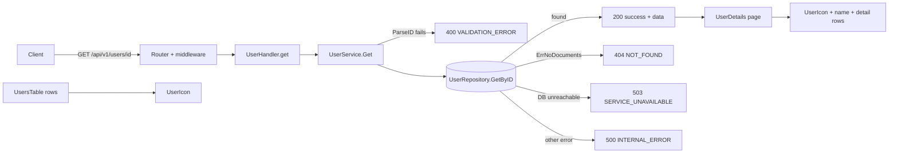

# Approved plan (version 3)

- Repository: `HeroicHorizon/DEMOAI`, base branch `main` at `e1d84b7508b67d4228c1c9222a54e9eb921732a3`
- Plan SHA-256: `ab99f00b593679e2e8940112412990f7aa1bd266b0065d7bdb20d99d7d956f72` (of the plan as approved; @​-mentions below are neutralised)
- Approval record: https://github.com/HeroicHorizon/DEMOAI/issues/3#issuecomment-6585896120

---

## Summary
The reviewer asks for a user icon in the UI. The backend plan from version 2 stays as it is: `GET /api/v1/users/{id}` already exists, and the work there is test coverage only. This revision adds a frontend change. A small `UserIcon` component shows a user avatar on the User Details page, which is the view that uses the Get User endpoint. The same icon also appears in the users list rows, so the UI is consistent. The icon is pure UI and needs no new backend field or API change.

## Acceptance criteria
1–8. Unchanged from the approved plan (the Get User endpoint criteria, the response envelope, unit tests and API-level tests).
9. The User Details page shows a user icon next to the user's name.
10. The users list shows the same icon beside each user's name.
11. The icon is decorative and does not change the existing text content or table column headers.

## Facts and assumptions
- [fact] `frontend/src/pages/UserDetails.tsx` renders an `<h1>User Details</h1>` and a `<dl className="details">` of rows. It has no icon or avatar.
- [fact] `frontend/src/components/UsersTable.tsx` renders `u.firstName` and `u.lastName` in separate cells and has no icon.
- [fact] The `User` type (`frontend/src/types.ts`) has no avatar or image field, and the API returns none.
- [fact] `frontend/src/pages/UserList.test.tsx` asserts the exact column header names with `getByRole('columnheader', { name })`. It also asserts the cell text `user1@​example.com`.
- [fact] `frontend/src/pages/UserDetails.test.tsx` uses `getByText` on each value, such as `id4`, `First4` and `ACTIVE`. Each value must therefore stay in its own element, and the icon must not duplicate any text.
- [fact] `frontend/src/styles.css` holds all styling, including `.badge` and `.details`. The frontend uses React 18, Vite, Vitest and Testing Library (`frontend/package.json`). `npm test` runs `vitest run`.
- [fact] Node 22 and npm 10 are installed in the container.
- [assumption] "User Icon" means a generic person glyph or an initials avatar, not an uploaded profile picture. The plan builds an inline SVG person glyph, because that needs no new dependency, no new data and no backend change.
- [assumption] The icon goes on the Details page and in the list rows. The reviewer didn't say where.

## Open questions
1. Should the icon be a generic person glyph or an avatar showing the user's initials?
   - Generic person glyph (inline SVG) (Recommended)
   - Initials avatar from first and last name
   - Uploaded profile picture (needs a backend field, so it is a larger change)
2. Where should the icon appear?
   - User Details page and the users list rows (Recommended)
   - User Details page only

## Tasks
1. Create `frontend/src/components/UserIcon.tsx`. It exports `UserIcon({ size?: number })`, an inline SVG person glyph with `aria-hidden="true"`, `focusable="false"` and `className="user-icon"`. It uses no new dependency.
2. In `frontend/src/pages/UserDetails.tsx`, wrap the heading in a header row. Put `<UserIcon size={48} />` beside the `<h1>User Details</h1>`, and show the full name next to it as a caption. Keep the existing `dl` rows unchanged, so the `getByText` assertions still match one element each. Render the name caption in a way that doesn't make `First4` or `Last4` match twice (for example, only the combined `First4 Last4` text node).
3. In `frontend/src/components/UsersTable.tsx`, render `<UserIcon size={20} />` inside the First Name cell, before the name text. Keep the header labels and column count (11) unchanged.
4. In `frontend/src/styles.css`, add `.user-icon` (colour, circular background, `flex-shrink: 0`) and a `.details-header { display: flex; align-items: center; gap: 0.75rem; }` rule.
5. Add the frontend tests listed in the Test plan.
6. Backend tasks 1–8 from the approved plan stay as they are (`user_handler_test.go`, `user_service_test.go`, `integration_test.go`, and only if a test fails, a fix in `user_handler.go`, `user_service.go` or `apperror.go`).

## Diagram


## Risks
- Wording like "user Icon" is ambiguous (see open questions). A picture upload would need a model, API and storage change that this plan does not include.
- Adding the icon or name text could create duplicate text matches in existing `getByText` tests. The tasks guard against this, and the existing tests must still pass unchanged.
- The real-MongoDB integration test is skipped without `MONGODB_TEST_URI`, and MongoDB is not installed here. API-level coverage comes from the router with `FakeRepo`.
- The behaviour for a missing id (`GET /api/v1/users/`) is not yet known, as before.
- Icon appearance can't be checked visually here. Tests only check that the icon renders.

## Impact
- Frontend: new `UserIcon.tsx`, edits to `UserDetails.tsx`, `UsersTable.tsx` and `styles.css`, plus new tests.
- Backend: test files only, as in the approved plan.
- No API contract, database, Docker or dependency changes.

## Toolchain
- Go 1.27.3 (pinned in `backend/go.mod`): already installed.
- Go modules (testify v1.10.0, mongo-driver v2.2.0): fetched by `go mod download`.
- Node 22.23.4 and npm 10.9.9: already installed. The frontend needs them (React 18, Vite 5, Vitest 2, TypeScript 5.6, versions as pinned in `frontend/package.json` and `package-lock.json`).
- MongoDB: optional and not installed. It is only needed for the skipped integration test.

## Test plan
Backend (Go `testing` with testify, in `backend/internal/...`), unchanged from the approved plan:
- `handler.TestGet_200EnvelopeShape` covers criteria 1, 2 and 6.
- `handler.TestGet_400And404` (extended) and `handler.TestGet_InvalidIDVariants` cover criteria 3, 4 and 6.
- `handler.TestGet_Unexpected500NoLeak` covers criteria 5 and 6.
- `handler.TestGet_MissingID` covers criterion 4.
- `service.TestGet_UnexpectedError` and `service.TestGet_EmptyID` in `user_service_test.go` cover criteria 4, 5 and 7.
- `server.TestMongoUnavailableReturns503` (extended with GET by id) and `server.TestLifecycleAgainstRealMongo` (extended) cover criterion 8.

Frontend (Vitest and Testing Library):
- `frontend/src/components/UserIcon.test.tsx`: `renders an svg hidden from assistive tech` checks `aria-hidden="true"` and `size` applied to width and height. It covers criteria 9 and 11.
- `frontend/src/pages/UserDetails.test.tsx`: `shows the user icon` checks that the `.user-icon` svg is present once the user loads, and that the existing field-value assertions still pass. It covers criteria 9 and 11.
- `frontend/src/pages/UserList.test.tsx`: `renders a user icon in each row` checks that the number of `.user-icon` elements equals the number of `user-row` rows, and that the existing header assertions still pass. It covers criteria 10 and 11.

## Commands
```
setup: cd backend && go mod download
setup: cd frontend && npm ci
build: cd backend && go build ./... && go vet ./...
build: cd frontend && npm run build
test: cd backend && go test -v -count=1 ./...
test: cd frontend && npx vitest run --reporter=verbose
```

## Complexity
S: the icon is one small component, two small edits and some CSS, plus the backend tests that were already planned. No backend production changes are expected.
